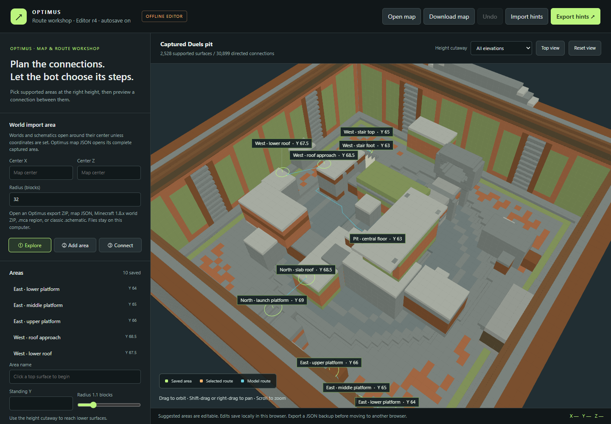

# Navigation

The planner works from collision geometry: walking, steps, drops and checked jumps. It replans around obstacles and moving targets, and waits when a route is unavailable.

Open `editor/index.html`. Load a map, add areas, preview directed connections, then **Export hints**. The bundled pit is an example; the map tools also work with other 1.8.x maps.

For another layout, put its map JSON at `config/optimus-route-map.json` and its hints at `config/optimus-route-hints.json`. Run `/o routes reload`, then `/o start`. Record custom arena corners with `/o pit a` and `/o pit b`; `/o entrance` records the entry point.

Use `/o visuals on` to inspect routes and jumps in the client. [Map export/import](MAPS.md) explains the file formats. Changing a map does not change which server contexts the bot supports.